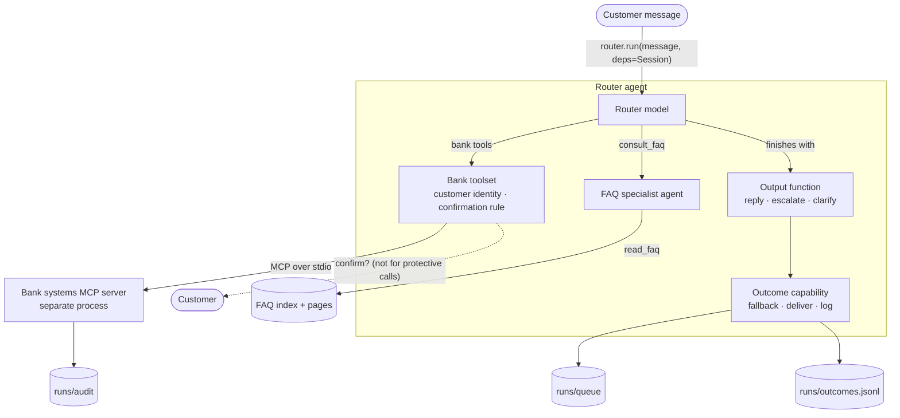

# Customer message routing prototype

A multi-agent prototype that triages customer messages sent to a bank's secure online-banking inbox. Each message
gets exactly one outcome: an automatic reply grounded in the FAQ, a bank action, a human handoff, or a clarifying
question. Built with [Pydantic AI](https://pydantic.dev/docs/ai/) on OpenAI, with a mock bank system behind MCP.

## How to run

Requires Python 3.12+ and `uv`. Run everything from the repository root.

```bash
uv sync
cp .env.example .env          # then fill in OPENAI_API_KEY
uv run python -m evals demo
```

An FAQ corpus is not included. Put your own in `data/faq/`: one Markdown page per article named `doc_NNN.md`
(first line `# Title`, then the article text), plus an `index.md` listing each ID with its title. The FAQ specialist
sees the index and opens pages by ID.

| Command | What it does |
| --- | --- |
| `uv run python -m request_routing` | Chat with the router (Pydantic AI's built-in chat CLI); bank actions ask you to confirm as the customer. |
| `uv run python -m evals demo` | Evaluates the five Banking77 demo messages in `data/demo_messages.json` (intent and handling). |
| `uv run python -m evals banking77 --n 30` | Intent accuracy on a seeded Banking77 test sample (demo rows excluded). |

Tests use scripted models, so they need no API key: `uv run pytest -q`.

## Architecture



Every agent run, model request and tool call is also traced to `runs/traces/` (OpenTelemetry).

A message is handled by one call: `await router.run(message, deps=Session(customer_id, confirm), usage_limits=LIMITS)`.
Everything else is attached to the agent, so chat, evals and tests behave the same.

| Component | Kind | Does | Cannot |
| --- | --- | --- | --- |
| Router | Pydantic AI agent | Classify, call `consult_faq` and bank tools, finish with one output function | Read FAQ pages directly |
| FAQ specialist | Pydantic AI agent | Read FAQ pages from the index | Act on accounts, escalate |
| Customer confirmation | Capability (`HandleDeferredToolCalls`) | Ask the customer to confirm bank calls that need it, inside the run | — |
| Outcome handling | Capability (`Hooks`) | Human fallback on any run error; deliver handoffs; log every outcome | — |
| Bank systems | MCP server (mock) | Seven operations across cards, payments and account | See model credentials; trust identity from tool arguments |

**Input and output structures** (`request_routing/schemas.py`):

- `Session` (deps): `customer_id`, `confirm` (how the customer answers), and what the tools did for the current
  message (`articles_read`, `actions`, `declined_actions`).
- `FaqAnswer` (FAQ specialist → router): `status` (answered / partially_answered / not_covered), `answer`,
  `citations`, `source_conflict`.
- `Outcome` (the run's output): `handling` (auto_reply / action_taken / human_handoff / clarification), `intent`,
  `domain`, `confidence`, `reply`, `citations`, `handoff`, `actions`, `declined_actions`.
- `Handoff` (to the human queue): `ticket_id`, `priority`, `reason`, `summary`, `customer_message`.

## Orchestration strategy

The router is a tool-using agent. It delegates information questions to the FAQ specialist (agent delegation:
`consult_faq` awaits the specialist and shares usage), calls bank tools for explicit operation requests, and
finishes by calling exactly one **output function**. Each output function checks the router's claims against the
session, the record of what the tools did, and raises `ModelRetry` if they don't match:

- `reply_to_customer` only accepts citations the FAQ specialist read, and needs grounding (citations or a bank action).
- `escalate_to_human` returns a ticket; `holding_reply` can give the customer FAQ self-service steps while they wait.
- `ask_clarification` is a reply asking one question. The answer arrives as a new message in the same thread.

Handling policy (`request_routing/agents/prompts/router.md`):

1. Information questions → FAQ specialist → cited reply, or a human if not covered.
2. Explicit operation requests → bank tool → reply quoting the result and reference.
3. Investigations, disputes, complaints, anything needing account data → human.
4. Security and fraud → urgent; block the card immediately if asked, then escalate for investigation.
5. Clarify only when the request can't be interpreted at all; otherwise escalate with a best guess, because inbox
   round trips take hours.

**FAQ retrieval** is index navigation in the spirit of PageIndex, not embeddings: the FAQ specialist reads the index of
article titles in its instructions, decides which pages to open, and reads them with `read_faq`. At 30 short
articles a flat index is enough; a larger corpus would get a tree (sections with summaries).

## Safety and guardrails

Enforced in code, not only in prompts:

- **Least privilege per agent**: each agent has its own toolset.
- **Grounding checks**: citations must have been read in this run (FAQ specialist output validator and router
  output functions), and customer-facing text may not expose internal article IDs. Unsupported replies are
  retried, then fall back to a human.
- **Confirmation is risk-based**: blocking a card (protective, reversible) runs immediately; every other bank operation
  needs the customer's confirmation (`requires_approval`, answered by the `HandleDeferredToolCalls` capability). A
  decline reaches the model as `ToolDenied`.
- **Confirmation is not authorization**: the bank server takes the customer identity from request metadata set by
  the bank toolset from the session, never from model-chosen arguments. A retried request within the same run
  returns the original result instead of running twice, and every operation is audited.
- **Process isolation**: the bank server runs as a separate process with only the runs directory in its
  environment, not the model credentials.
- **Allowlisted operations**: the model can only call operations the server exposes, with typed arguments.
- **Usage limits**: at most 15 model requests and 10 tool calls per message, across both agents.
- **Fallback**: any run error (limits, retries exhausted, API errors) is recovered by the `run_error` hook into a
  human handoff with reason `system_fallback`.
- **Prompt injection**: the customer message is treated as data, and the tools are narrow. This reduces the risk
  but does not eliminate it.

`tests/test_guardrails.py` checks these rules with scripted `FunctionModel`s.

## Tracking and monitoring

- **Traces**: every agent run, model request and tool call is an OpenTelemetry span (GenAI semantic conventions),
  written per message to `runs/traces/<trace_id>.jsonl` by a small file exporter. In production you'd swap in
  `OTLPSpanExporter` to send them to a collector (Logfire, Langfuse, Datadog), and set `include_content=False` to
  keep customer text out of the trace store.
- **Outcome log**: `runs/outcomes.jsonl` has one business-level record per message (intent, domain, handling,
  latency, tokens, model requests, tool calls, articles read, trace ID), written by the outcome-handling capability.
- **Evals**: Pydantic Evals reports pass/fail per case plus requests, tokens and cost per message.
- **Queue and audit**: `runs/queue/handoffs.jsonl` and `runs/audit/actions.jsonl`.

## Assumptions and design choices

- **Channel**: the bank's secure online-banking inbox, not a live chat. One message in, one outcome out. A
  clarifying question is a terminal outcome for that message.
- **Intents**: the 77 Banking77 labels, plus `other`. **Domains**: six groups of our own (`request_routing/taxonomy.py`);
  domain is derived from intent.
- **Handling is not determined by intent alone**: "how do I cancel a transfer" is an FAQ question; "cancel my last
  transfer" is an action.
- **The FAQ corpus is not part of the repository.** Development used a small synthetic corpus of 30 short articles.
  When articles disagree, the FAQ specialist reports the conflict instead of merging them.
- **Banking77 comes from a UK fintech** (top-ups, virtual cards, crypto), so a general bank FAQ covers few of its
  intents. Not covered → human is the common path.
- **Bank actions are mocks**: they record a request and return a reference. Nothing is executed.

## Evaluation

- **Intent** is measured against Banking77 labels (`evals banking77`). The router is zero-shot, so nothing is trained. Use
  the train split for prompt iteration and error analysis, and keep the test split as a holdout. The demo rows come
  from the test split and prompted three general prompt fixes (read all relevant articles, plain text, no article
  IDs in replies), so `evals banking77` excludes them.
- **Handling** has no ground truth in Banking77. The `expected_handling` labels in `data/demo_messages.json` are our
  own, assigned from the policy above.

## Out of scope

Real customer data and bank APIs, authentication, a production queue, multi-turn state beyond a chat thread, a web
UI, and evaluation of handling at scale. These would come next in a production design.

## Layout

```
request_routing/              the solution
  __main__.py                 chat with the router
  config.py                   paths, model, .env
  schemas.py                  Session (deps), FaqAnswer, Outcome, Handoff
  taxonomy.py                 Banking77 intents → domains
  tracing.py                  OpenTelemetry setup + file exporter
  agents/
    router.py                 router agent, consult_faq, output functions, LIMITS
    faq.py                    FAQ specialist and its grounding validator
    toolsets/                 what the agents can do
      bank.py                 MCP client for the bank: connection, customer identity, confirmation rule
      faq.py                  read_faq over the FAQ index and pages
    capabilities/             what happens around a run
      confirmation.py         customer confirms or declines bank calls (HandleDeferredToolCalls)
      outcomes.py             human fallback, handoff delivery, outcome log (Hooks)
    prompts/                  router.md, faq.md
evals/                        Pydantic Evals: demo set and Banking77 sample (python -m evals)
mcp_servers/
  bank/server.py              mock bank systems MCP server (separate process; imports nothing from request_routing)
data/
  faq/                        FAQ index + pages (bring your own; contents not committed)
  banking77/                  Banking77 train/test splits (CC BY 4.0, PolyAI)
  demo_messages.json
runs/                         what runs write: traces/, queue/, audit/, outcomes.jsonl (folders kept, contents ignored)
tests/                        guardrail tests with scripted models
```

Imports only point downwards: `evals` → `request_routing`; inside it, `__main__` → `agents` →
`schemas`/`taxonomy`/`config`. `request_routing` never imports `evals`, and `mcp_servers` imports nothing from
`request_routing`.

## License

The code is MIT-licensed (see `LICENSE`). The Banking77 data in `data/banking77/` is from
[PolyAI/banking77](https://huggingface.co/datasets/PolyAI/banking77) (Casanueva et al., 2020) under CC BY 4.0.
